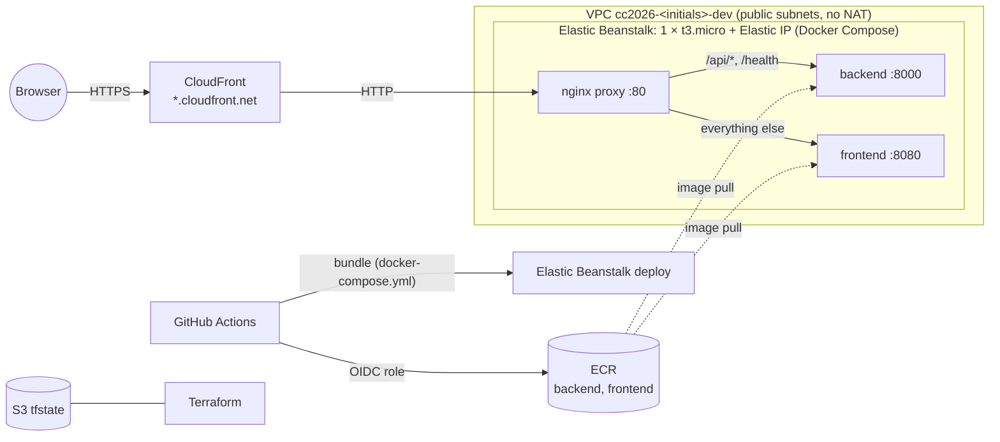

# CC2026 – Infrastructure (AWS)

Terraform, bootstrap and CI/CD for the *Cloud Computing* project (UTCN, 2026–2027) on **AWS**. It is the AWS counterpart of [`CC2026_DS_Infra`](https://github.com/agi1clj/CC2026_DS_Infra) (Azure) and runs the same, unchanged applications from [`CC2026_DS_Applications`](https://github.com/agi1clj/CC2026_DS_Applications).

> Students: name your copy `CC2026_LastName_FirstName_Infra_AWS`. This reference copy is called `CC2026_DS_Infra_AWS`.
> **Start with [docs/student-walkthrough.md](docs/student-walkthrough.md)**.

## Quick start (about 15 minutes)

Tools: `aws` ≥ 2.32, `gh`, `terraform` ≥ 1.14, `git`, `jq`. New to AWS / free account: first follow **[docs/aws-account-setup.md](docs/aws-account-setup.md)** (account, IAM user, `aws login`, credits).

```bash
aws login --profile cc2026 --region eu-central-1   # free/personal account (IAM user)
#   or: aws sso login --profile <profile>           # organization with IAM Identity Center
gh auth login --scopes workflow

export AWS_PROFILE=cc2026
./bootstrap/bootstrap.sh --check                # read-only: tells you what will work
./bootstrap/bootstrap.sh                        # creates everything and starts the first deployment
```

It asks for initials, region and repo names (saved to `bootstrap/bootstrap.env`; safe to re-run) and prints the URL. Creating the environment takes 5–8 min; the first deployment another 4–6 min in GitHub Actions (until then the URL shows the Elastic Beanstalk sample page).

Afterwards: push to Apps `main` deploys; Infra changes go through *Actions → terraform → Run workflow* (or local `terraform apply`).

## Architecture



| Azure (CC2026_DS_Infra) | AWS (this repository) |
|---|---|
| Storage account `tfstate` | S3 bucket `cc2026-<initials>-tfstate-<account>` (versioned, S3-native locking) |
| Entra app + federated credentials | IAM OIDC provider + roles `github-actions-cc2026-<initials>-apps` / `-infra` |
| Resource group | Tags (`project`, `owner`, `environment`) + a dedicated VPC |
| ACR Basic | ECR repositories `cc2026-<initials>-dev/backend`, `/frontend` |
| App Service Plan B1 + 2 Web Apps | Elastic Beanstalk single-instance Docker environment (t3.micro) running both containers |
| `*.azurewebsites.net` HTTPS | CloudFront `https://<id>.cloudfront.net` (no domain or certificate needed) |
| User-assigned identity (AcrPull) | EC2 instance role (ECR pull, logs; attach more for P2) |
| Two-stage create (`CREATE_WEB_APPS`) | Not needed: the environment starts with a sample app |

**Cost** (eu-central-1, 24/7): ≈ USD 0.45/day, ≈ 13/month (t3.micro 8.80, Elastic IP 3.65, 8 GB disk 0.75; ECR, CloudWatch, CloudFront and S3 are cents). USD 100 of credits lasts longer than the 6-month Free plan. See [credits and limits](docs/aws-account-setup.md#3-credits-and-the-6-month-limit).

The instance also answers on `http://<cname>.elasticbeanstalk.com` (Elastic Beanstalk opens port 80 for single-instance environments). CloudFront adds HTTPS; it is not an access control.

## Terraform layout

```text
terraform/
├── bootstrap/            GitHub OIDC + IAM roles (applied locally by bootstrap.sh only)
├── environments/dev/     root module: network, registry, CDN, Elastic Beanstalk
│   └── tests/            offline `terraform test` (mocked provider)
└── modules/
    ├── naming/           all names and tags (used by both roots)
    ├── network/          VPC, 2 public subnets, internet gateway
    ├── container-registry/  ECR repositories + lifecycle policy
    ├── cdn/              CloudFront distribution (HTTPS, caching disabled)
    └── beanstalk/        application, single-instance environment, IAM roles, bundle bucket
```

## How deployments work

The Apps workflow `deploy-aws` tests both apps, pushes both images tagged with the commit SHA, writes those image names into `deploy/aws/docker-compose.yml`, zips it with the proxy config, and deploys it as a new application version (`scripts/deploy-beanstalk.sh`). Elastic Beanstalk pulls the images and restarts the containers (all at once: a few seconds of downtime). The workflow then waits until `/health` and `/version.txt` report the new SHA.

Terraform owns the environment settings, including the environment variables the containers get (`API_BASE_URL`, `CORS_ORIGINS`); it never sets the application version. A newer platform version does not change the environment on `terraform apply`; update it in the console (*Environment → Platform → Change version*) when you choose to.

## GitHub variables (set by bootstrap.sh, no secrets)

| Repository | Variables |
|---|---|
| Apps | `AWS_REGION`, `AWS_DEPLOY_ROLE_ARN`, `ECR_REPOSITORY_PREFIX`, `EB_APPLICATION`, `EB_ENVIRONMENT`, `EB_BUNDLE_BUCKET`, `AWS_APP_URL` |
| Infra | `AWS_REGION`, `AWS_ACCOUNT_ID`, `AWS_INFRA_ROLE_ARN`, `TFSTATE_BUCKET`, `PROJECT_NAME`, `STUDENT_INITIALS`, `ENABLE_CDN` |

Azure and AWS can coexist in the Apps repo; each cloud deploys only if its variable exists (`AZURE_CLIENT_ID` / `AWS_DEPLOY_ROLE_ARN`).

## Permissions

- **Apps role**: push to the two ECR repos, upload bundles, and AWS's `AdministratorAccess-AWSElasticBeanstalk` (a deployment acts on the resources behind the environment).
- **Infra role**: `PowerUserAccess` + IAM limited to `cc2026-<initials>-dev-*` roles, instance profiles and policies.
- Both trust only `main` of their own repo. Both are broad: use your own account, not a shared one.

## Common errors

| Symptom | Fix |
|---|---|
| `Not logged in to AWS` / `session has expired` | `aws login --profile cc2026` (or `aws sso login`); sessions last up to 12 h |
| `account must be verified` (CloudFront) | New account: `ENABLE_CDN=false ./bootstrap/bootstrap.sh`, or ask AWS Support to enable CloudFront ([details](docs/aws-account-setup.md#4-free-account-issues)) |
| URL shows "Congratulations" sample page | The first deployment has not finished; watch `deploy-aws` in the Apps repo |
| `deploy-beanstalk.sh`: deployment failed | The events printed by the workflow say why; container logs: Elastic Beanstalk console → *Logs → Request last 100 lines*, or CloudWatch log group `/aws/elasticbeanstalk/cc2026-<initials>-dev/...` |
| Containers restart / out of memory | Set `instance_type = "t3.small"` (2 GiB, ≈ USD 17.50/month) and apply |
| Terraform: `account ... not allowed` | You are logged in to a different account than the one in `terraform.tfvars` |
| `VPC quota reached` / `Elastic IP quota reached` | 5 per region by default; delete unused ones or request more |

More: [docs/extending.md](docs/extending.md) (P2 data pipeline with S3/Glue, P3 sign-in with Cognito).
