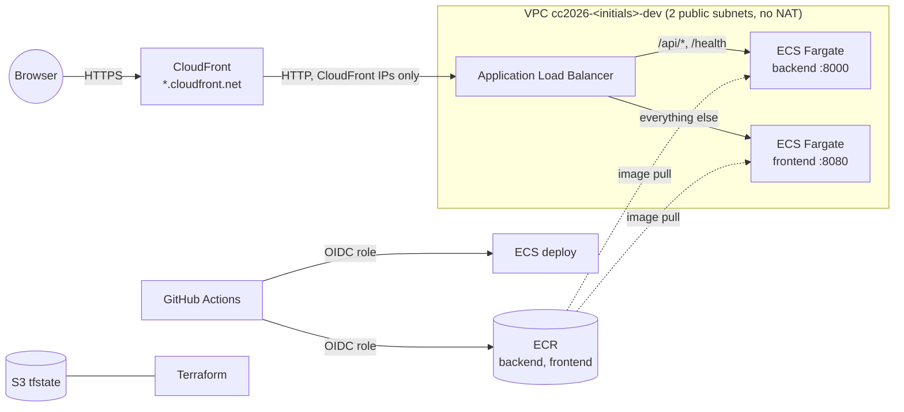

# CC2026 – Infrastructure (AWS)

Terraform, bootstrap and CI/CD for the *Cloud Computing* project (UTCN, 2026–2027) on **AWS**. It is the AWS counterpart of [`CC2026_DS_Infra`](https://github.com/agi1clj/CC2026_DS_Infra) (Azure) and runs the same, unchanged applications from [`CC2026_DS_Applications`](https://github.com/agi1clj/CC2026_DS_Applications).

> Students: name your copy `CC2026_LastName_FirstName_Infra_AWS`. This reference copy is called `CC2026_DS_Infra_AWS`.

## Quick start (about 10 minutes)

Tools: `aws` (v2), `gh`, `terraform` ≥ 1.14, `git`, `jq`.

```bash
aws sso login --profile <your-profile>          # or any login that works with `aws sts get-caller-identity`
gh auth login --scopes workflow

export AWS_PROFILE=<your-profile>
./bootstrap/bootstrap.sh --check                # read-only: tells you what will work
./bootstrap/bootstrap.sh                        # creates everything and starts the first deployment
```

The script asks for your initials, region (default `eu-central-1`) and repository names (defaults come from the git remote), saves the answers in `bootstrap/bootstrap.env`, and is safe to re-run. At the end it prints the URL. The first image build and deploy take another 3–5 minutes in GitHub Actions.

After that:
- **Apps**: every push to `main` builds, pushes and deploys (`backend-aws`, `frontend-aws` workflows).
- **Infra**: change Terraform, push, then *Actions → terraform → Run workflow* (or `terraform apply` locally).

## Architecture



| Azure (CC2026_DS_Infra) | AWS (this repository) |
|---|---|
| Storage account `tfstate` | S3 bucket `cc2026-<initials>-tfstate-<account>` (versioned, S3-native locking) |
| Entra app + federated credentials | IAM OIDC provider + roles `github-actions-cc2026-<initials>-apps` / `-infra` |
| Resource group | Tags (`project`, `owner`, `environment`) + a dedicated VPC |
| ACR Basic | ECR repositories `cc2026-<initials>-dev/backend`, `/frontend` |
| App Service Plan B1 + 2 Web Apps | ECS cluster + 2 Fargate services (0.25 vCPU / 0.5 GB each) behind one ALB |
| `*.azurewebsites.net` HTTPS | CloudFront `https://<id>.cloudfront.net` (no domain or certificate needed) |
| User-assigned identity (AcrPull) | Task execution role (ECR pull, logs) + task role (for P2 data access) |
| Two-stage create (`CREATE_WEB_APPS`) | Not needed: ECS services may exist before the first image |

Frontend and API share one origin (`/api/*` is routed to the backend), so the browser makes no cross-origin calls; `CORS_ORIGINS` is still set to the CloudFront URL.

**Cost** (eu-central-1, running 24/7): ALB ≈ $18/month, two Fargate tasks ≈ $18/month, ECR/CloudWatch/CloudFront/S3 cents. Stop the apps without deleting anything: set `desired_count = 0`. Remove everything: `./scripts/cleanup.sh`.

## Terraform layout

```text
terraform/
├── bootstrap/            GitHub OIDC + IAM roles (applied locally by bootstrap.sh only)
├── environments/dev/     root module: network, registry, load balancer, CDN, ECS services
│   └── tests/            offline `terraform test` (mocked provider)
└── modules/
    ├── naming/           all names and tags (used by both roots)
    ├── network/          VPC, 2 public subnets, internet gateway
    ├── container-registry/  ECR repositories + lifecycle policy
    ├── load-balancer/    ALB, path routing, security groups (ALB: CloudFront only; tasks: ALB only)
    ├── cdn/              CloudFront distribution (HTTPS, caching disabled)
    └── ecs-services/     cluster, IAM roles, log groups, task definitions, services
```

## How deployments work

Terraform creates each task definition with the `:latest` image and ignores later revisions (`ignore_changes = [task_definition]`). The Apps workflows push `<sha>` and `latest`, then `scripts/deploy-ecs.sh` copies the **newest** revision of the family, swaps in the `<sha>` image, registers it and updates the service. Settings changed by Terraform (environment variables, CPU, memory) therefore reach the containers on the next app deployment; re-run the Apps workflows after such a change. A deployment whose tasks never become healthy is rolled back automatically (ECS circuit breaker) and the workflow fails.

## GitHub variables (set by bootstrap.sh, no secrets)

| Repository | Variables |
|---|---|
| Apps | `AWS_REGION`, `AWS_DEPLOY_ROLE_ARN`, `ECS_CLUSTER`, `ECR_REPOSITORY_PREFIX`, `AWS_APP_URL` |
| Infra | `AWS_REGION`, `AWS_ACCOUNT_ID`, `AWS_INFRA_ROLE_ARN`, `TFSTATE_BUCKET`, `PROJECT_NAME`, `STUDENT_INITIALS` |

The Apps repository can be configured for Azure and AWS at the same time; each cloud's workflows run only when their variables exist (`AZURE_CLIENT_ID` / `AWS_DEPLOY_ROLE_ARN`).

## Permissions

- **Apps role**: push to the two ECR repositories, register task definitions, update the two ECS services, pass the two task roles to ECS. Nothing else.
- **Infra role**: `PowerUserAccess` (every non-IAM service) plus IAM limited to roles/policies named `cc2026-<initials>-dev-*`. It cannot change its own role or the Apps role. Use a dedicated sandbox account: anyone who can push to `main` of the Infra repository can run Terraform with this role.
- Both roles trust only the `main` branch of their own repository.

## Common errors

| Symptom | Fix |
|---|---|
| `Not logged in to AWS` | `aws sso login --profile <profile>`; SSO sessions expire after a few hours |
| Site returns 502/503 right after bootstrap | The first images are still being built; watch the Apps workflows |
| `deploy-ecs.sh`: rolled back | The new container did not pass its health check; `aws logs tail /ecs/cc2026-<initials>-dev/<app> --follow` |
| Terraform: `account ... not allowed` | You are logged in to a different account than the one in `terraform.tfvars` |
| `VPC quota reached` | Max 5 VPCs per region by default; delete an unused one or request more |

More: [docs/extending.md](docs/extending.md) (P2 data pipeline with S3/Glue, P3 sign-in with Cognito).
