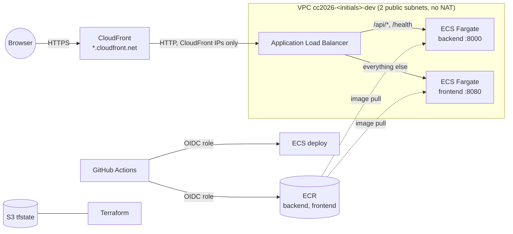

# CC2026 – Infrastructure (AWS)

Terraform, bootstrap and CI/CD for the *Cloud Computing* project (UTCN, 2026–2027) on **AWS**. It is the AWS counterpart of [`CC2026_DS_Infra`](https://github.com/agi1clj/CC2026_DS_Infra) (Azure) and runs the same, unchanged applications from [`CC2026_DS_Applications`](https://github.com/agi1clj/CC2026_DS_Applications).

> Students: name your copy `CC2026_LastName_FirstName_Infra_AWS`. This reference copy is called `CC2026_DS_Infra_AWS`.

## Quick start (about 10 minutes)

Tools: `aws` ≥ 2.32, `gh`, `terraform` ≥ 1.14, `git`, `jq`. New to AWS / free account: first follow **[docs/aws-account-setup.md](docs/aws-account-setup.md)** (account, IAM user, `aws login`, credits).

```bash
aws login --profile cc2026 --region eu-central-1   # free/personal account (IAM user)
#   or: aws sso login --profile <profile>           # organization with IAM Identity Center
gh auth login --scopes workflow

export AWS_PROFILE=cc2026
./bootstrap/bootstrap.sh --check                # read-only: tells you what will work
./bootstrap/bootstrap.sh                        # creates everything and starts the first deployment
```

It asks for initials, region and repo names (saved to `bootstrap/bootstrap.env`; safe to re-run) and prints the URL. The first image build takes another 3–5 min in GitHub Actions.

Afterwards: push to Apps `main` deploys; Infra changes go through *Actions → terraform → Run workflow* (or local `terraform apply`).

## Architecture



| Azure (CC2026_DS_Infra) | AWS (this repository) |
|---|---|
| Storage account `tfstate` | S3 bucket `cc2026-<initials>-tfstate-<account>` (versioned, S3-native locking) |
| Entra app + federated credentials | IAM OIDC provider + roles `github-actions-cc2026-<initials>-apps` / `-infra` |
| Resource group | Tags (`project`, `owner`, `environment`) + a dedicated VPC |
| ACR Basic | ECR repositories `cc2026-<initials>-dev/backend`, `/frontend` |
| App Service Plan B1 + 2 Web Apps | ECS cluster + 2 Fargate services (0.25 vCPU / 0.5 GB each) behind one ALB |
| `*.azurewebsites.net` HTTPS | CloudFront `https://<id>.cloudfront.net` (no domain or certificate needed) |
| User-assigned identity (AcrPull) | Task execution role (ECR pull, logs) + task role (for P2 data access) |
| Two-stage create (`CREATE_WEB_APPS`) | Not needed: ECS services may exist before the first image |

**Cost** (eu-central-1, 24/7): ≈ USD 1.80/day (ALB, two 0.25-vCPU Fargate tasks, four public IPv4 addresses; ECR/CloudWatch/CloudFront/S3 are cents). Pause by destroying (step 1 of `./scripts/cleanup.sh`) and resume with `./bootstrap/bootstrap.sh`; see [credits and the 6-month Free-plan limit](docs/aws-account-setup.md#3-credits-and-the-6-month-limit).

## Terraform layout

```text
terraform/
├── bootstrap/            GitHub OIDC + IAM roles (applied locally by bootstrap.sh only)
├── environments/dev/     root module: network, registry, load balancer, CDN, ECS services
│   └── tests/            offline `terraform test` (mocked provider)
└── modules/
    ├── naming/           all names and tags (used by both roots)
    ├── network/          VPC, 2 public subnets, internet gateway
    ├── container-registry/  ECR repositories + lifecycle policy
    ├── load-balancer/    ALB, path routing, security groups (ALB: CloudFront only; tasks: ALB only)
    ├── cdn/              CloudFront distribution (HTTPS, caching disabled)
    └── ecs-services/     cluster, IAM roles, log groups, task definitions, services
```

## How deployments work

Terraform creates task definitions with `:latest` and ignores later revisions. The Apps workflows push `<sha>` + `latest`; `scripts/deploy-ecs.sh` copies the newest revision, swaps in `<sha>` and updates the service. Terraform changes to env/CPU/memory reach containers on the next app deploy. Unhealthy deployments roll back (ECS circuit breaker).

## GitHub variables (set by bootstrap.sh, no secrets)

| Repository | Variables |
|---|---|
| Apps | `AWS_REGION`, `AWS_DEPLOY_ROLE_ARN`, `ECS_CLUSTER`, `ECR_REPOSITORY_PREFIX`, `AWS_APP_URL` |
| Infra | `AWS_REGION`, `AWS_ACCOUNT_ID`, `AWS_INFRA_ROLE_ARN`, `TFSTATE_BUCKET`, `PROJECT_NAME`, `STUDENT_INITIALS` |

Azure and AWS can coexist in the Apps repo; each cloud deploys only if its variable exists (`AZURE_CLIENT_ID` / `AWS_DEPLOY_ROLE_ARN`).

## Permissions

- **Apps role**: push to the two ECR repos, register task definitions, update the two services. Nothing else.
- **Infra role**: `PowerUserAccess` + IAM limited to `cc2026-<initials>-dev-*`. Broad: use a sandbox account.
- Both trust only `main` of their own repo.

## Common errors

| Symptom | Fix |
|---|---|
| `Not logged in to AWS` / `session has expired` | `aws login --profile cc2026` (or `aws sso login`); sessions last up to 12 h |
| `account must be verified` (CloudFront) | New account: `ENABLE_CDN=false ./bootstrap/bootstrap.sh`, or ask AWS Support to enable CloudFront ([details](docs/aws-account-setup.md#4-free-account-issues)) |
| Site returns 502/503 right after bootstrap | The first images are still being built; watch the Apps workflows |
| `deploy-ecs.sh`: rolled back | The new container did not pass its health check; `aws logs tail /ecs/cc2026-<initials>-dev/<app> --follow` |
| Terraform: `account ... not allowed` | You are logged in to a different account than the one in `terraform.tfvars` |
| `VPC quota reached` | Max 5 VPCs per region by default; delete an unused one or request more |

More: [docs/extending.md](docs/extending.md) (P2 data pipeline with S3/Glue, P3 sign-in with Cognito).
