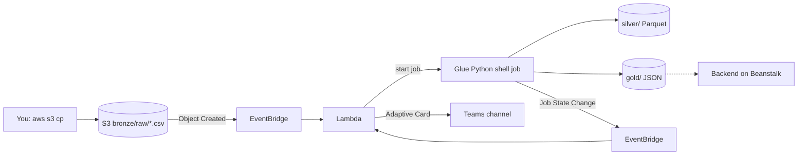

# P2 — Student Walkthrough (AWS data pipeline)

P2 adds a data pipeline to your platform: you upload a CSV with 525,600 energy readings, and AWS cleans it and writes small JSON files. Teams tells you when it is done. About 2 hours, in two labs.

Replace `<github-user>`, `<LastName>_<FirstName>` and `<initials>` as in the [P1 walkthrough](student-walkthrough.md). Work in your Infra repo.

## What is provided and what you build

| Part | Who |
|---|---|
| S3 bucket, Glue job, Lambda, EventBridge rules, IAM, Teams card, backend read access (Terraform) | Provided |
| Glue script: bronze to silver (cleaning, Parquet files per date) and the gold file `daily_energy_by_device.json` | Provided |
| Gold files `energy_by_location.json` and `latest_readings.json` (Glue script) | **You build** (Lab 2) |
| One extra gold file with a time grouping, one extra data-quality rule | Optional bonus |
| Charts and API in the Apps repo | **You build** (next: Apps challenge) |

## How it works



One bucket, three zones (prefixes): `bronze/` raw upload (never changed), `silver/` clean typed Parquet, `gold/` small JSON files for the backend. The backend reads gold only.

**Cost:** Glue costs about USD 0.05–0.15 per run. Lambda, EventBridge and S3 cost cents. Do not run the job in a loop.

---

# Lab 1 — Deploy and run the pipeline

## 1. Get the P2 code

Your instructor publishes P2 as a branch or pull request of `CC2026_DS_Infra_AWS`. Merge it into `main` of your Infra repo:

```bash
cd CC2026_<LastName>_<FirstName>_Infra_AWS
git remote add template https://github.com/agi1clj/CC2026_DS_Infra_AWS   # once
git fetch template feature/p2-data-pipeline
git merge template/feature/p2-data-pipeline --allow-unrelated-histories -m "feat: P2 data pipeline"
git push
```

The P1 roles from `bootstrap.sh` already cover P2: you do **not** need to run it again. (If the instructor says the roles changed, run `./bootstrap/bootstrap.sh` again. Note that it rewrites `terraform/environments/dev/terraform.tfvars`, so add the Teams line from step 2 again.)

## 2. Create the Teams webhook

The old "Incoming Webhook" connector is retired. Use a Teams **Workflow**.

1. In Teams, pick a channel (a private team of your own is fine). Open `...` next to the channel name, then **Workflows**.
2. Choose the template **Send webhook alerts to a channel**. Name it `cc2026-pipeline`, select the team and channel, then **Add workflow**.
3. Copy the **webhook URL**. It is a secret: anyone with it can post to your channel.
4. If the template is missing: in Power Automate create a flow from blank with the trigger **When a Teams webhook request is received**, and add the action **Post card in a chat or channel** with the card from `body.attachments[0].content`. Teams menus change, so follow what the screen shows.
5. The university tenant may block Workflows. Then ask your instructor, or use a channel in a personal Microsoft account. Without a webhook the pipeline still works; you only miss the cards.

Test the URL once:

```bash
export TEAMS_WEBHOOK_URL='<paste the URL>'
curl -sS -o /dev/null -w '%{http_code}\n' -H 'Content-Type: application/json' \
  -d '{"type":"message","attachments":[{"contentType":"application/vnd.microsoft.card.adaptive","content":{"type":"AdaptiveCard","version":"1.4","$schema":"http://adaptivecards.io/schemas/adaptive-card.json","body":[{"type":"TextBlock","text":"CC2026 webhook test"}]}}]}' \
  "$TEAMS_WEBHOOK_URL"
```

Expected: HTTP `200` or `202`, and the card appears in the channel within a minute.

Store the URL in two places:

```bash
gh secret set TEAMS_WEBHOOK_URL --repo <github-user>/CC2026_<LastName>_<FirstName>_Infra_AWS   # paste when asked
echo 'teams_webhook_url = "<paste the URL>"' >> terraform/environments/dev/terraform.tfvars   # git-ignored
```

## 3. Deploy

GitHub: **Actions → terraform → Run workflow** (branch `main`). Or from the terminal:

```bash
gh workflow run terraform --repo <github-user>/CC2026_<LastName>_<FirstName>_Infra_AWS
gh run watch --repo <github-user>/CC2026_<LastName>_<FirstName>_Infra_AWS
```

The workflow creates the bucket, Glue job, Lambda and rules (about 2 minutes). The Elastic Beanstalk containers restart once, because they get the new variables `DATA_BUCKET` and `GOLD_PREFIX`.

Find the bucket name and keep it in a variable:

```bash
export AWS_PROFILE=cc2026
BUCKET=$(terraform -chdir=terraform/environments/dev output -raw data_bucket_name)
JOB=$(terraform -chdir=terraform/environments/dev output -raw glue_job_name)
LAMBDA=$(terraform -chdir=terraform/environments/dev output -raw pipeline_lambda_name)
echo "$BUCKET $JOB $LAMBDA"
```

(No local state access? The same values are in the workflow run summary.)

## 4. Generate the data and upload it

```bash
python3 scripts/generate_dataset.py --out data     # about 10 seconds, writes data/energy_readings.csv (32 MB, git-ignored)
aws s3 cp data/energy_readings.csv "s3://$BUCKET/bronze/raw/energy_readings.csv"
```

The upload starts the pipeline. Only `.csv` files under `bronze/raw/` count.

### Know your bronze data

Bronze is the raw file. Nobody cleaned it. It has the problems that real sensor data has. Find them before the pipeline removes them.

| Problem | Rows | Example row |
|---|---|---|
| Empty `kwh` | 2,584 | `device-001,2025-11-04T03:15:00Z,20.34,54.31,,Office-A` |
| Negative `kwh` | 1,043 | `device-001,2025-11-02T10:15:00Z,22.14,57.25,-0.0834,Office-A` |
| Humidity above 100 % | 1,018 | `device-001,2025-11-01T06:50:00Z,20.9,140.0,0.0639,Office-A` |
| Temperature `-999` (sensor error code) | 540 | `device-001,2025-11-02T19:30:00Z,-999.0,56.25,0.0619,Office-A` |
| Exact duplicate rows | 2,110 | the same `device_id` and `timestamp` twice |

The raw file has 532,895 rows. 7,295 of them are extra copies of real readings. Cleaning leaves 525,600 rows: 5 devices x 105,120 readings (one every 5 minutes for 365 days).

Why this matters: one `-999` in a day of 288 readings moves the daily average temperature by about 3.5 degrees. A negative `kwh` lowers the daily total. Silver exists so that gold never sees these rows.

Check it yourself (no pandas needed):

```bash
awk -F, 'NR>1 { if ($5=="") e++; else if ($5<0) n++; if ($4>100) h++; if ($3==-999) t++ }
  END {print "empty kwh:", e, "| negative kwh:", n, "| humidity>100:", h, "| temperature -999:", t}' data/energy_readings.csv
cut -d, -f1,2 data/energy_readings.csv | sort | uniq -d | wc -l     # keys that appear twice (7295)
```

The silver step does three things: it gives each column a type (`timestamp` as a real timestamp, numbers as `double`), it removes the bad rows above, and it keeps one row per `device_id` + `timestamp`.

## 5. Watch it run

```bash
# Lambda: "Started <job> run jr_..." (a few seconds after the upload)
aws logs tail "/aws/lambda/$LAMBDA" --since 10m

# Glue job runs: RUNNING, then SUCCEEDED (about 2-4 minutes)
aws glue get-job-runs --job-name "$JOB" --max-items 3 \
  --query 'JobRuns[].[Id,JobRunState,ExecutionTime,ErrorMessage]' --output table

# Job output (use the run id from the table)
aws logs tail /aws-glue/python-jobs/output --log-stream-name-prefix <run-id>
```

Console: **AWS Glue → ETL jobs → your job → Runs**.

Teams shows a green card **CC2026 P2 pipeline SUCCEEDED** with the file name, run id and time.

## 6. Look at silver and gold

```bash
aws s3 ls "s3://$BUCKET/silver/energy_readings/" | head          # one folder per day: date=2025-11-01/ ...
aws s3 ls "s3://$BUCKET/gold/"
aws s3 cp "s3://$BUCKET/gold/daily_energy_by_device.json" - | head -n 20
```

Silver has 525,600 clean rows (the raw file has 532,895). The job removed empty or negative `kwh`, humidity above 100, temperature `-999` and duplicates.

## 7. Make it fail on purpose

`data/energy_invalid.csv` has no `kwh` column.

```bash
aws s3 cp data/energy_invalid.csv "s3://$BUCKET/bronze/raw/energy_invalid.csv"
```

The Glue run ends as `FAILED` (error `Missing required columns: kwh`). Teams shows a red card **CC2026 P2 pipeline FAILED**. Silver and gold keep the data of the last good run.

**Lab 1 is done when** you saw silver files, the green card and the red card.

---

# Lab 2 — Your part: write two gold functions

The Glue script is `terraform/modules/data-pipeline/glue/energy_etl.py`. Each gold file comes from one small function: it gets the clean silver table (a pandas DataFrame `df` with columns `device_id, timestamp, temperature, humidity, kwh, location, date`) and returns a list of records.

You write:

| File | Records |
|---|---|
| `gold/energy_by_location.json` | 5 records: `{location, total_kwh, devices, avg_kwh_per_day}`. Sorted by `location`. |
| `gold/latest_readings.json` | 200 records: `{device_id, timestamp, temperature, humidity, kwh, location}`. Newest first. |

The expected output of the full dataset is in the Apps repo, folder `docs/p2-sample-data/gold/` (or `p2-raw-data/expected-gold/` from your instructor). Rounding: `total_kwh` 3 decimals, averages 2 decimals, `avg_kwh_per_day` 3 decimals.

## The finished example, line by line

```python
def gold_daily_by_device(df):
    daily = (
        df.groupby(["device_id", "location", "date"], as_index=False)  # one group per device and day
        .agg(
            total_kwh=("kwh", seq_sum),                  # new column = (source column, function)
            temperature_sum=("temperature", seq_sum),    # sums now, divided by readings below
            humidity_sum=("humidity", seq_sum),
            readings=("kwh", "size"),                    # number of rows in the group
        )
        .sort_values(["device_id", "date"])              # the order of the output file
    )
    daily["total_kwh"] = py_round(daily["total_kwh"], 3)  # py_round(column, decimals)
    daily["avg_temperature"] = py_round(daily["temperature_sum"] / daily["readings"], 2)
    daily["avg_humidity"] = py_round(daily["humidity_sum"] / daily["readings"], 2)
    columns = ["device_id", "location", "date", "total_kwh", "avg_temperature", "avg_humidity", "readings"]
    return daily[columns].to_dict("records")             # list of dicts = JSON array
```

`seq_sum` is a plain sum that matches the reference files to the last digit. For your functions, the normal `"sum"` is fine.

## Your function 1: `gold_by_location`

Copy the pattern. Fill the `TODO` gaps:

```python
def gold_by_location(df):
    by_location = (
        df.groupby("TODO: the grouping column", as_index=False)
        .agg(
            total_kwh=("kwh", "sum"),
            devices=("device_id", "TODO: count distinct values"),   # hint: nunique
            days=("date", "TODO: count distinct values"),
        )
        .sort_values("location")
    )
    # avg_kwh_per_day = total kWh / number of days (use the UNROUNDED total)
    by_location["avg_kwh_per_day"] = py_round(by_location["TODO"] / by_location["days"], 3)
    by_location["total_kwh"] = py_round(by_location["total_kwh"], 3)
    return by_location[["location", "total_kwh", "devices", "avg_kwh_per_day"]].to_dict("records")
```

## Your function 2: `gold_latest_readings`

Hint: `df.sort_values([...], ascending=False)` then `.head(200)`. Sort by `timestamp`, then `device_id`, both descending. Write the timestamp back as text like `2026-10-31T23:55:00Z` with `.dt.strftime("%Y-%m-%dT%H:%M:%SZ")`. Keep only the six raw columns (`REQUIRED_COLUMNS`) in that order.

## Register and deploy

Remove the `#` of your lines in `GOLD_OUTPUTS`:

```python
GOLD_OUTPUTS = {
    "daily_energy_by_device.json": gold_daily_by_device,
    "energy_by_location.json": gold_by_location,
    "latest_readings.json": gold_latest_readings,
}
```

Then:

```bash
git add -A && git commit -m "feat(p2): gold by location and latest readings" && git push
gh workflow run terraform --repo <github-user>/CC2026_<LastName>_<FirstName>_Infra_AWS   # uploads the new script (its hash changed)
gh run watch --repo <github-user>/CC2026_<LastName>_<FirstName>_Infra_AWS
```

Run the job again with the data that is already in S3 (no new upload needed):

```bash
aws glue start-job-run --job-name "$JOB" \
  --arguments "{\"--bucket\":\"$BUCKET\",\"--key\":\"bronze/raw/energy_readings.csv\"}"
```

You get a Teams card when it ends. A re-upload of the CSV does the same.

## Compare with the expected files

```bash
aws s3 cp "s3://$BUCKET/gold/energy_by_location.json" /tmp/by_location.json
aws s3 cp "s3://$BUCKET/gold/latest_readings.json" /tmp/latest.json
python3 - <<'EOF'
import json
for mine, expected in [("/tmp/by_location.json", "energy_by_location.json"), ("/tmp/latest.json", "latest_readings.json")]:
    same = json.load(open(mine)) == json.load(open("<path to expected-gold>/" + expected))
    print(expected, "OK" if same else "DIFFERENT")
EOF
```

Different? Check, in this order: the sort order, the rounding, the column names and order, and whether you used the unrounded total for `avg_kwh_per_day`. If the job failed, read the error in `/aws-glue/python-jobs/error`.

**Lab 2 is done when** both files print `OK`.

## Optional bonus

1. **A time grouping.** Add one more gold file, for example `energy_by_hour.json` (kWh by hour of day, 24 records, group by `df["timestamp"].dt.hour`), by weekday (`dt.dayofweek`) or by month (`df["date"].str[:7]`). Register it in `GOLD_OUTPUTS`. Use it in your Apps charts.
2. **One more data-quality rule** in `clean()` (for example, drop `kwh` above 5 as a sensor error). Make a small CSV with bad rows, upload it to `bronze/raw/`, and check silver.

---

## Next: Apps challenge

Open `docs/p2-challenge.md` in the Apps repository. The backend already has read access to `gold/` (variables `DATA_BUCKET` and `GOLD_PREFIX=gold/`). You add the API endpoints and the charts.

## Troubleshooting

| Symptom | Fix |
|---|---|
| Upload done, no Lambda log line | The file must be `bronze/raw/<name>.csv` (exact prefix, `.csv` end). Check `aws s3 ls "s3://$BUCKET/bronze/raw/"` |
| Lambda log: `ConcurrentRunsExceededException` | A run is still active. Wait for it to end and upload again |
| Glue run `FAILED`: `Missing required columns` | The CSV header is wrong. Use `data/energy_readings.csv` (header `device_id,timestamp,temperature,humidity,kwh,location`) |
| Glue run `FAILED`: `ModuleNotFoundError` (pandas, pyarrow) | The job needs `library-set = analytics` (set in Terraform). Do not remove it |
| Glue run `FAILED`: `AccessDenied` | Check you did not change the IAM policy of the Glue role; run the terraform workflow again |
| Glue run `FAILED` with a Python error after your edit | Read `aws logs tail /aws-glue/python-jobs/error --log-stream-name-prefix <run-id>` |
| Edit not used by the job | You did not run the terraform workflow after the push (it uploads the script) |
| No Teams card | Check the log line `Teams notification failed` or `No Teams webhook configured` in the Lambda log. Check secret `TEAMS_WEBHOOK_URL` and that the terraform workflow ran after you set it. Check the flow's run history in Power Automate |
| Teams card is raw JSON text | The flow must use the action **Post card in a chat or channel** with the card from the request |
| `terraform apply` says `AccessDenied` for IAM | Run `./bootstrap/bootstrap.sh` again to refresh the roles |
| Backend cannot read gold (later) | See the IMDS note in [extending.md](extending.md#how-p2-is-built-reference) |

Clean up: `./scripts/cleanup.sh` removes the pipeline too (the bucket is emptied automatically).
